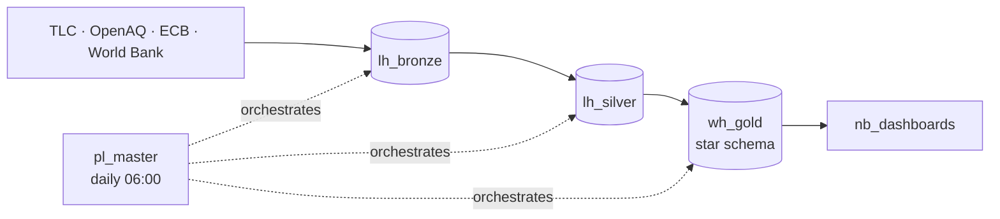
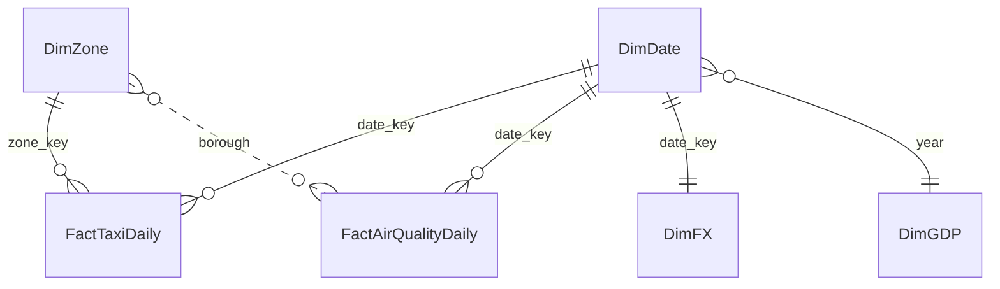

# Architecture

## Overview

A medallion architecture on Microsoft Fabric. Each layer has one job.

| Layer | Fabric item | Content | Written by |
|---|---|---|---|
| Bronze | Lakehouse `lh_bronze` | Raw files and raw API tables, exactly as delivered | Data pipeline, Dataflows Gen2 |
| Silver | Lakehouse `lh_silver` | Cleaned, typed, deduplicated Delta tables | PySpark notebooks |
| Gold | Warehouse `wh_gold` | Star schema and reporting views | PySpark notebook into T-SQL tables |

The detailed flow is in [lineage.md](lineage.md); tables and columns are in
[data-dictionary.md](data-dictionary.md).

## Star schema

`DimFX` and `DimGDP` are joined through the date: FX by day, GDP by year. Air quality is measured
at monitoring stations, not taxi zones, so it relates to zones at borough level.

## Design decisions

| Decision | Reason |
|---|---|
| Everything is deployed through Fabric Git integration | The workspace can be rebuilt from the repository, and every change is reviewable |
| Taxi files are copied by a pipeline; APIs are loaded by Dataflows Gen2 | Each tool is used for what it does best: bulk file copy versus shaping API responses |
| A notebook lists which taxi months to copy | TLC publishes about two months late; asking the source which files exist avoids failed copies and re-downloading |
| A notebook calls OpenAQ and the dataflow shapes the JSON | OpenAQ needs a secret key. A dataflow would store the key in its definition, which is committed to Git; the notebook reads it from a OneLake file instead |
| A notebook calls Open-Meteo and the dataflow shapes the JSON | Requests to Open-Meteo from a Dataflow Gen2 fail in the Fabric service, while the same request from a notebook succeeds |
| Notebooks find lakehouses by name at run time | No workspace or lakehouse ID is hard-coded, so notebooks work in any workspace |
| Gold tables are defined in T-SQL and loaded from a notebook | Warehouse Git integration does not support procedures that read from a lakehouse; the Spark connector for Fabric Warehouse does the load |
| Gold is fully reloaded on every run | At daily grain the tables are small; a full reload cannot drift or duplicate |
| Trips are processed month by month, only for new months | The trip table is the only large one; reprocessing it daily would waste capacity |
| Notebooks run one after another | A small capacity cannot run several Spark sessions at the same time |
| Air-quality stations are mapped to the nearest borough centre | Mapping stations to individual taxi zones needs the zone shapefile and spatial joins; borough level is enough for the questions asked |
| "Time of day" compares daily pollution with trips per time band | Hourly pollution for every station would multiply API calls by 24 for little extra insight |
| Yellow taxi only, from 2024-01 by default | Fits a small capacity; `start_month` loads more history when capacity allows |

## Known limitations

- A station close to a borough boundary can be assigned to the neighbouring borough.
- Dataflow destinations, the HTTP connection and the Notebook connection hold IDs of the workspace they were created in
  (see [setup.md](setup.md), section 2.4).
- Correlations between trips and pollution describe co-movement, not cause: weather and season
  affect both.
