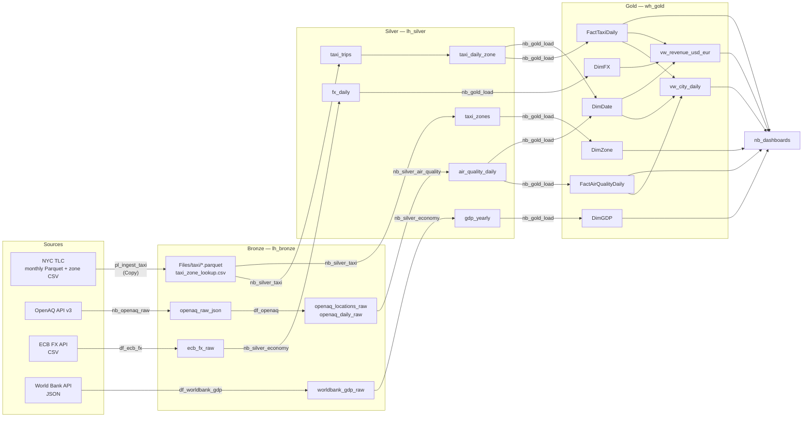
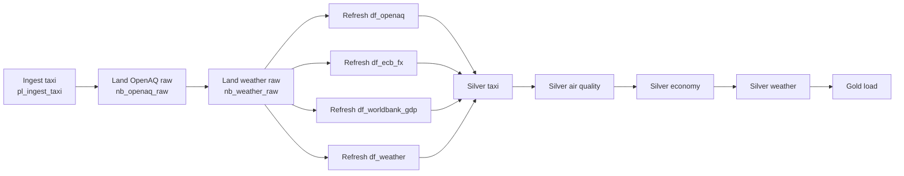

# Data lineage

How data moves from each source to the dashboards, and which Fabric item performs each step.

## Orchestration

`pl_master` runs the whole chain once a day at 06:00.

Each step starts only when the previous one succeeded, so a failure stops the run and leaves the
gold layer as it was after the last good run.

## Column-level lineage of the key measures

| Gold column | Derived from |
|---|---|
| `FactTaxiDaily.trips` | Count of rows in `taxi_trips` per `trip_date` and `pickup_zone_id` |
| `FactTaxiDaily.total_amount` | Sum of TLC `total_amount` |
| `FactTaxiDaily.trips_<band>` | Count of trips whose `tpep_pickup_datetime` hour falls in the band |
| `FactAirQualityDaily.avg_value` | OpenAQ daily `value` per sensor, converted to µg/m³, averaged over the station's sensors of that pollutant |
| `FactAirQualityDaily.borough` | Station `coordinates`, nearest borough centre |
| `DimFX.usd_per_eur` | ECB `OBS_VALUE`, carried forward over non-business days |
| `DimGDP.yoy_growth_pct` | World Bank `value` against the previous year |
| `vw_revenue_usd_eur.revenue_eur` | `FactTaxiDaily.total_amount` × `DimFX.eur_per_usd` of the same day |

The weather flow and the external integrations that read the gold layer are shown in
[integrations.md](integrations.md).

Microsoft Purview lineage is optional in the assignment and is not enabled. The workspace
**Lineage view** in Fabric shows the same item-level graph automatically.
